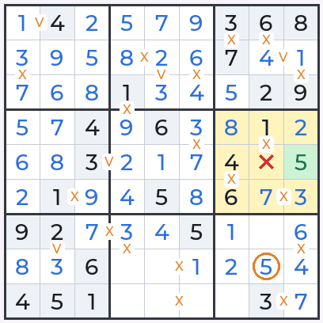

<!-- Written by tools/walkthrough.py xv: edit the script, not this page. -->
# XV, step 49: the 5 in box 6

**Step 49 of 57** · [← Step 48](step-48.md) · [All steps](../xv.md#the-whole-puzzle-step-by-step) · [Step 50 →](step-50.md)

Box 6 needs a 5. r5c8: column 8 has one (r8c8). Only **r5c9** is left: **r5c9 = 5**.

**Step 49 of 57** · [← Step 48](step-48.md) · [All steps](../xv.md#the-whole-puzzle-step-by-step) · [Step 50 →](step-50.md)
