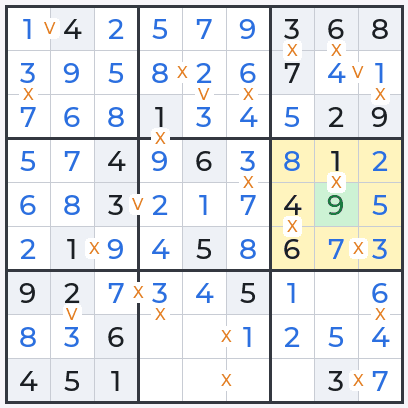

<!-- Written by tools/walkthrough.py xv: edit the script, not this page. -->
# XV, step 50: the 9 in box 6

**Step 50 of 57** · [← Step 49](step-49.md) · [All steps](../xv.md#the-whole-puzzle-step-by-step) · [Step 51 →](step-51.md)

Box 6 needs a 9, and r5c8 is its last empty cell: **r5c8 = 9**.

**Step 50 of 57** · [← Step 49](step-49.md) · [All steps](../xv.md#the-whole-puzzle-step-by-step) · [Step 51 →](step-51.md)
