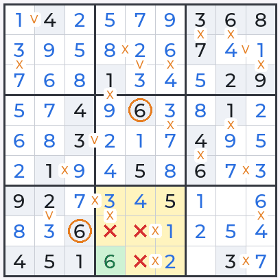

<!-- Written by tools/walkthrough.py xv: edit the script, not this page. -->
# XV, step 52: the 6 in box 8

**Step 52 of 57** · [← Step 51](step-51.md) · [All steps](../xv.md#the-whole-puzzle-step-by-step) · [Step 53 →](step-53.md)

Box 8 needs a 6. r8c4 and r8c5: row 8 has one (r8c3). r9c5: column 5 has one (r4c5). Only **r9c4** is left: **r9c4 = 6**.

**Step 52 of 57** · [← Step 51](step-51.md) · [All steps](../xv.md#the-whole-puzzle-step-by-step) · [Step 53 →](step-53.md)
