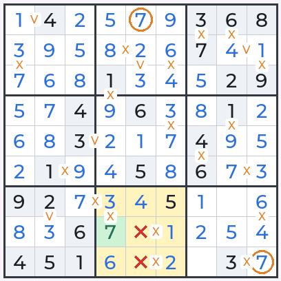

<!-- Written by tools/walkthrough.py xv: edit the script, not this page. -->
# XV, step 53: the 7 in box 8

**Step 53 of 57** · [← Step 52](step-52.md) · [All steps](../xv.md#the-whole-puzzle-step-by-step) · [Step 54 →](step-54.md)

Box 8 needs a 7. r8c5: column 5 has one (r1c5). r9c5: row 9 has one (r9c9). Only **r8c4** is left: **r8c4 = 7**.

**Step 53 of 57** · [← Step 52](step-52.md) · [All steps](../xv.md#the-whole-puzzle-step-by-step) · [Step 54 →](step-54.md)
