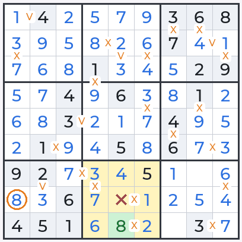

<!-- Written by tools/walkthrough.py xv: edit the script, not this page. -->
# XV, step 54: the 8 in box 8

**Step 54 of 57** · [← Step 53](step-53.md) · [All steps](../xv.md#the-whole-puzzle-step-by-step) · [Step 55 →](step-55.md)

Box 8 needs an 8. r8c5: row 8 has one (r8c1). Only **r9c5** is left: **r9c5 = 8**.

**Step 54 of 57** · [← Step 53](step-53.md) · [All steps](../xv.md#the-whole-puzzle-step-by-step) · [Step 55 →](step-55.md)
