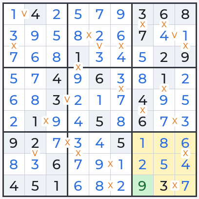

<!-- Written by tools/walkthrough.py xv: edit the script, not this page. -->
# XV, step 57: the 9 in box 9

**Step 57 of 57** · [← Step 56](step-56.md) · [All steps](../xv.md#the-whole-puzzle-step-by-step) · [All steps](../xv.md#the-whole-puzzle-step-by-step)

Box 9 needs a 9, and r9c7 is its last empty cell: **r9c7 = 9**.

Solved.

**Step 57 of 57** · [← Step 56](step-56.md) · [All steps](../xv.md#the-whole-puzzle-step-by-step) · [All steps](../xv.md#the-whole-puzzle-step-by-step)
