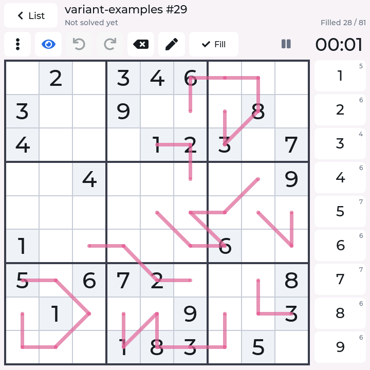
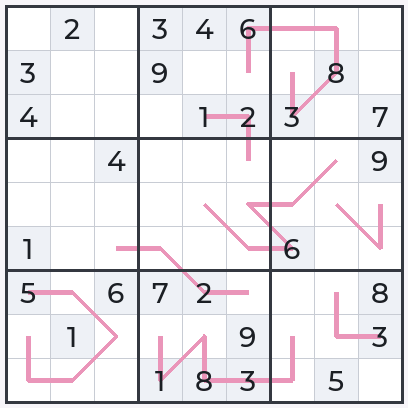

# Zipper Lines

[← All variants](README.md) · [Puzzles](../features-puzzles.md) · [How to play](../how-to-play.md)

## The rules

[Classic](classic.md) rules, plus **pink lines** through cells side by side or diagonal. Fold a line in half at its middle: every two cells that meet **add up to the same total**. On a line with a middle cell (an odd number of cells), that total is the **middle cell's digit**: 1, 3, 7, 4, 6 works because 1 + 6 = 3 + 4 = 7. On a line without one, the total is whatever the two middle cells add up to.

Two cells that pair up may hold the same digit when they don't share a row, column or box (2 + 2 = 4).

## On the board

- Each line is a narrow pink line under the digits.
- Two full pairs with different totals, or (on an odd line) a pair that can't make the middle digit any more, turn red.
- The grader and hints work out the totals the line can still have, from its middle cell and its other pairs, and each cell's digit as a total less its partner's: "Cells the same distance from this line's middle add up to the same total, so row 6, column 5 can only be 5".
- **Puzzles → ⋮ → New puzzle → Lines → Zipper**: 8 lines (Hard and Expert 10) of 3 to 7 cells.

## How to solve it

- **The middle digit is the total:** on an odd line, every pair adds up to it, so every other cell on the line is smaller than it. A middle 2 means 1 + 1 everywhere.
- **One full pair gives the total** for every other pair on the line (and the middle digit, on an odd line).
- **Partners are complements:** once the total is known, a cell's candidates are the total less its partner's candidates.
- **Small totals, small digits:** a total of 5 keeps every cell on the line to 1–4.

## Worked example

**variant-examples #29**, Zipper Lines Easy (see [Classic](classic.md#worked-example-the-whole-puzzle) for how to import the examples; cells are written r*row*c*column*). The lines are in the screenshot; two matter here:

- a line of **seven** around the top of box 3: r2c7, r3c7 (a 3), r2c8 (an 8), r1c8 (its middle), r1c7, r1c6 (a 6) and r2c6;
- another line of **seven** in the bottom middle: r8c4, r9c4 (a 1), r8c5, r9c5 (an 8, its middle), r9c6 (a 3), r9c7 and r8c7.

**Step 1: r1c8, the middle of the first line.** Row 1 has 2, 3, 4 and 6; column 8 has 5 and 8; box 3 has a 7: that leaves 1 and 9. Its 2nd and 6th cells pair up: 3 + 6 = 9, so every pair adds up to 9, and so is the middle. **r1c8 = 9**.

**Step 2: r1c7, the same line's 5th cell.** Row 1 now has 2, 3, 4, 6 and 9; box 3 has 7 and 8: that leaves 1 and 5. It pairs with the 3rd cell, r2c8, an 8: 8 + r1c7 = 9. **r1c7 = 1**.

**Step 3: r8c5, the second line's 3rd cell.** Row 8 has 1, 3 and 9; column 5 has 1, 2, 4 and 8; box 8 has 2, 3, 7 and 8: that leaves 5 and 6. The line's middle is an 8, so every pair adds up to 8, and r8c5 pairs with r9c6, a 3. **r8c5 = 5**.

## The whole puzzle, step by step

<!-- walkthrough -->
<!-- Written by tools/walkthrough.py zipper-lines: edit the script, not this part. -->

The whole puzzle, from the start to the last cell: 53 steps, each one a single (one place left for a digit, or one digit left for a cell), taken in the order a box's single comes first, so not quite the order of the worked example above. Each step has a page of its own, with **Previous** and **Next**: pick one from the list below. In each picture, the unit the step looks at is tinted yellow (for a cell with one digit left: its row, column and box), the new digit is on green, the digits that rule cells out have an **orange ring**, and the empty cells they rule out a **red cross**. Givens are on grey, digits from earlier steps in blue.

1. [the 8 in box 2](zipper-lines/step-01.md)
2. [the 3 in box 7](zipper-lines/step-02.md)
3. [the 4 in box 7](zipper-lines/step-03.md)
4. [the 8 in box 7](zipper-lines/step-04.md)
5. [the 8 in box 1](zipper-lines/step-05.md)
6. [the 2 in box 7](zipper-lines/step-06.md)
7. [the 7 in box 7](zipper-lines/step-07.md)
8. [the 9 in box 7](zipper-lines/step-08.md)
9. [the 6 in box 8](zipper-lines/step-09.md)
10. [the 4 in box 8](zipper-lines/step-10.md)
11. [the 5 in box 8](zipper-lines/step-11.md)
12. [the 5 in box 2](zipper-lines/step-12.md)
13. [the 7 in box 2](zipper-lines/step-13.md)
14. [the 7 in box 1](zipper-lines/step-14.md)
15. [the 1 in box 1](zipper-lines/step-15.md)
16. [the 2 in box 3](zipper-lines/step-16.md)
17. [the 4 in box 3](zipper-lines/step-17.md)
18. [the 5 in box 3](zipper-lines/step-18.md)
19. [the 1 in box 3](zipper-lines/step-19.md)
20. [the 6 in box 3](zipper-lines/step-20.md)
21. [the 6 in box 1](zipper-lines/step-21.md)
22. [the 9 in box 3](zipper-lines/step-22.md)
23. [the 1 in box 9](zipper-lines/step-23.md)
24. [the 1 in box 6](zipper-lines/step-24.md)
25. [the 1 in box 5](zipper-lines/step-25.md)
26. [the 2 in box 9](zipper-lines/step-26.md)
27. [the 4 in box 9](zipper-lines/step-27.md)
28. [the 4 in box 6](zipper-lines/step-28.md)
29. [the 4 in box 5](zipper-lines/step-29.md)
30. [the 2 in box 5](zipper-lines/step-30.md)
31. [the 2 in box 4](zipper-lines/step-31.md)
32. [the 6 in box 4](zipper-lines/step-32.md)
33. [the 5 in box 5](zipper-lines/step-33.md)
34. [the 6 in box 5](zipper-lines/step-34.md)
35. [the 9 in box 5](zipper-lines/step-35.md)
36. [the 3 in box 5](zipper-lines/step-36.md)
37. [the 2 in box 6](zipper-lines/step-37.md)
38. [the 3 in box 6](zipper-lines/step-38.md)
39. [the 3 in box 4](zipper-lines/step-39.md)
40. [the 6 in box 9](zipper-lines/step-40.md)
41. [the 7 in box 9](zipper-lines/step-41.md)
42. [the 7 in box 6](zipper-lines/step-42.md)
43. [the 8 in box 5](zipper-lines/step-43.md)
44. [the 7 in box 5](zipper-lines/step-44.md)
45. [the 7 in box 4](zipper-lines/step-45.md)
46. [the 8 in box 6](zipper-lines/step-46.md)
47. [the 8 in box 4](zipper-lines/step-47.md)
48. [the 9 in box 4](zipper-lines/step-48.md)
49. [the 9 in box 1](zipper-lines/step-49.md)
50. [the 5 in box 1](zipper-lines/step-50.md)
51. [the 5 in box 4](zipper-lines/step-51.md)
52. [the 5 in box 6](zipper-lines/step-52.md)
53. [the 9 in box 9](zipper-lines/step-53.md)

Solved.

<!-- /walkthrough -->
