# Zipper Lines

[← All variants](README.md) · [Puzzles](../features-puzzles.md) · [How to play](../how-to-play.md)

## The rules

[Classic](classic.md) rules, plus **pink lines** through cells side by side or diagonal. Fold a line in half at its middle: every two cells that meet **add up to the same total**. On a line with a middle cell (an odd number of cells), that total is the **middle cell's digit**: 1, 3, 7, 4, 6 works because 1 + 6 = 3 + 4 = 7. On a line without one, the total is whatever the two middle cells add up to.

Two cells that pair up may hold the same digit when they don't share a row, column or box (2 + 2 = 4).

## On the board

- Each line is a narrow pink line under the digits.
- Two full pairs with different totals, or (on an odd line) a pair that can't make the middle digit any more, turn red.
- The grader and hints work out the totals the line can still have, from its middle cell and its other pairs, and each cell's digit as a total less its partner's: "Cells the same distance from this line's middle add up to the same total, so row 6, column 5 can only be 5".
- **Puzzles → ⋮ → New puzzle → Lines → Zipper**: 8 lines (Hard and Expert 10) of 3 to 7 cells.

## How to solve it

- **The middle digit is the total:** on an odd line, every pair adds up to it, so every other cell on the line is smaller than it. A middle 2 means 1 + 1 everywhere.
- **One full pair gives the total** for every other pair on the line (and the middle digit, on an odd line).
- **Partners are complements:** once the total is known, a cell's candidates are the total less its partner's candidates.
- **Small totals, small digits:** a total of 5 keeps every cell on the line to 1–4.

## Worked example

**variant-examples #29**, Zipper Lines Easy (see [Classic](classic.md#worked-example-the-whole-puzzle) for how to import the examples; cells are written r*row*c*column*). The lines are in the screenshot; three matter here:

- a line of **six**: r5c4 (a 6), r6c5, r7c4 (a 4), r7c3 (a 6), r7c2 (a 5) and r8c1;
- a line of **three**: r9c3 (a 2), r8c4 and r9c4 (a 5);
- a line of **five**: r4c9, r4c8 (an 8), r3c8 (a 9), r2c8 and r1c7 (an 8).

**Step 1: r6c5, on the line of six.** Row 6 has 4, 6, 8 and 9; column 5 has 1, 2 and 3. By the Classic rules r6c5 could be 5 or 7. The line has no middle cell, so its middle pair sets the total: r7c4 and r7c3, 4 + 6 = 10. r6c5 pairs with r7c2, a 5. **r6c5 = 5**.

**Step 2: r8c4, the middle of the line of three.** Row 8 has a 2; column 4 has 1, 4, 5, 6 and 8; box 8 has a 3; that leaves 7 and 9. Its ends add up to 2 + 5 = 7, and the middle digit is that total. **r8c4 = 7**.

**Step 3: r2c8, on the line of five.** Row 2 has a 3; column 8 has 4, 6, 8 and 9; box 3 has a 5; that leaves 1, 2 and 7. The line's middle cell, r3c8, is a 9, so every pair adds up to 9. r2c8 pairs with r4c8, an 8. **r2c8 = 1**.

## The whole puzzle, step by step

<!-- walkthrough -->
<!-- Written by tools/walkthrough.py zipper-lines: edit the script, not this part. -->

The whole puzzle, from the start to the last cell: 49 steps, each one a single (one place left for a digit, or one digit left for a cell), taken in the order a box's single comes first, so not quite the order of the worked example above. In each picture, the unit the step looks at is tinted yellow (for a cell with one digit left: its row, column and box), the new digit is on green, the digits that rule cells out have an **orange ring**, and the empty cells they rule out a **red cross**. Givens are on grey, digits from earlier steps in blue.

#### Step 1: the 4 in box 2

Box 2 needs a 4. r1c4 and r2c4: column 4 has one (r7c4). r2c6: column 6 has one (r5c6). Only **r1c5** is left: **r1c5 = 4**.

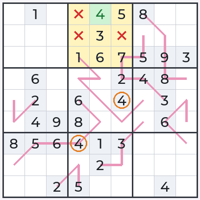

#### Step 2: the 8 in box 2

Box 2 needs an 8. r1c4: row 1 has one (r1c7). r2c4: column 4 has one (r6c4). Only **r2c6** is left: **r2c6 = 8**.

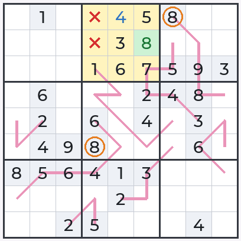

#### Step 3: the 4 in box 3

Box 3 needs a 4. r1c8 and r1c9: row 1 has one (r1c5). r2c7: column 7 has one (r4c7). r2c8: column 8 has one (r9c8). Only **r2c9** is left: **r2c9 = 4**.

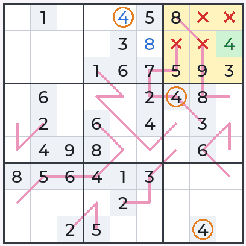

#### Step 4: the 1 in box 3

Box 3 needs a 1. r1c8 and r1c9: row 1 has one (r1c2). r2c7: it pairs with the 3 in r5c8 on its pink line, whose pairs add up to 9: it's 6. Only **r2c8** is left: **r2c8 = 1**.

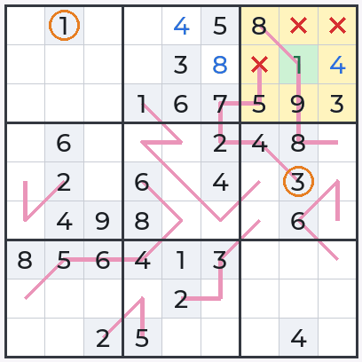

#### Step 5: the 8 in box 4

Box 4 needs an 8. r4c1 and r4c3: row 4 has one (r4c8). r5c1: column 1 has one (r7c1). r6c1: row 6 has one (r6c4). Only **r5c3** is left: **r5c3 = 8**.

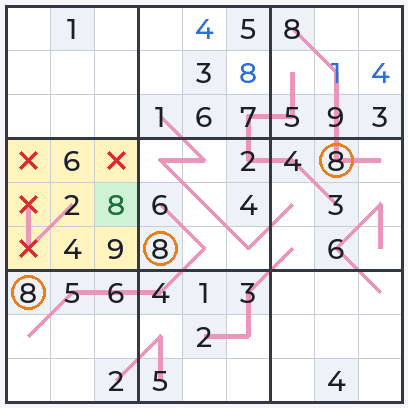

#### Step 6: the 8 in box 1

Box 1 needs an 8. r1c1 and r1c3: row 1 has one (r1c7). r2c1, r2c2 and r2c3: row 2 has one (r2c6). r3c1: column 1 has one (r7c1). r3c3: column 3 has one (r5c3). Only **r3c2** is left: **r3c2 = 8**.

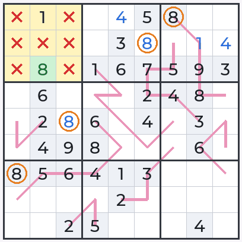

#### Step 7: the 1 in box 5

Box 5 needs a 1. r4c4: column 4 has one (r3c4). r4c5, r5c5 and r6c5: column 5 has one (r7c5). Only **r6c6** is left: **r6c6 = 1**.

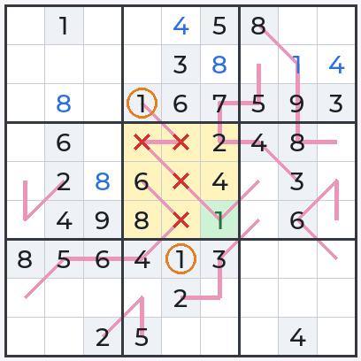

#### Step 8: the 3 in box 5

Box 5 needs a 3. r4c5 and r6c5: column 5 has one (r2c5). r5c5: row 5 has one (r5c8). Only **r4c4** is left: **r4c4 = 3**.

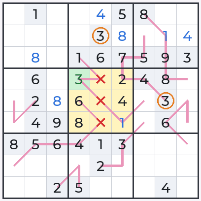

#### Step 9: the 3 in box 4

Box 4 needs a 3. r4c1 and r4c3: row 4 has one (r4c4). r5c1: row 5 has one (r5c8). Only **r6c1** is left: **r6c1 = 3**.

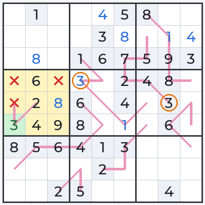

#### Step 10: the 3 in box 1

Box 1 needs a 3. r1c1: column 1 has one (r6c1). r2c1, r2c2 and r2c3: row 2 has one (r2c5). r3c1 and r3c3: row 3 has one (r3c9). Only **r1c3** is left: **r1c3 = 3**.

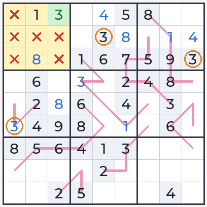

#### Step 11: the 9 in box 5

Box 5 needs a 9. r6c5: row 6 has one (r6c3). r5c5: with a 9 there, its pink line's pairs couldn't all add up to the same. Only **r4c5** is left: **r4c5 = 9**.

#### Step 12: the 5 in box 5

Box 5 needs a 5. r5c5: it pairs with the 3 in r4c4 on its pink line, whose pairs add up to 10: it's 7. Only **r6c5** is left: **r6c5 = 5**.

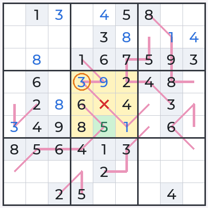

#### Step 13: the 7 in box 5

Box 5 needs a 7, and r5c5 is its last empty cell: **r5c5 = 7**.

#### Step 14: the 5 in box 6

Box 6 needs a 5. r5c7: column 7 has one (r3c7). r6c7 and r6c9: row 6 has one (r6c5). r4c9: it pairs with the 8 in r1c7 on its pink line, whose pairs add up to 9: it's 1. Only **r5c9** is left: **r5c9 = 5**.

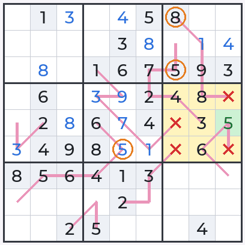

#### Step 15: the 1 in box 6

Box 6 needs a 1. r6c7 and r6c9: row 6 has one (r6c6). r5c7: it pairs with the 1 in r3c4 on its pink line, whose pairs add up to 10: it's 9. Only **r4c9** is left: **r4c9 = 1**.

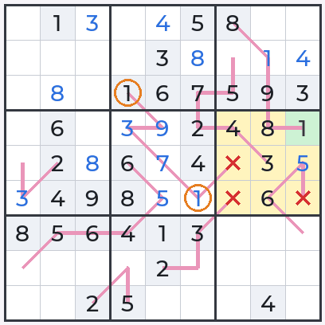

#### Step 16: the 1 in box 4

Box 4 needs a 1. r4c1 and r4c3: row 4 has one (r4c9). Only **r5c1** is left: **r5c1 = 1**.

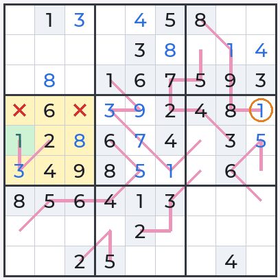

#### Step 17: the 9 in box 6

Box 6 needs a 9. r6c7 and r6c9: row 6 has one (r6c3). Only **r5c7** is left: **r5c7 = 9**.

#### Step 18: the 1 in box 7

Box 7 needs a 1. r8c1 and r9c1: column 1 has one (r5c1). r8c2 and r9c2: column 2 has one (r1c2). Only **r8c3** is left: **r8c3 = 1**.

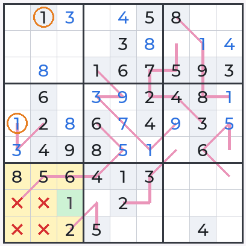

#### Step 19: the 4 in box 7

Box 7 needs a 4. r8c2: column 2 has one (r6c2). r9c1 and r9c2: row 9 has one (r9c8). Only **r8c1** is left: **r8c1 = 4**.

#### Step 20: the 4 in box 1

Box 1 needs a 4. r1c1: row 1 has one (r1c5). r2c1, r2c2 and r2c3: row 2 has one (r2c9). r3c1: column 1 has one (r8c1). Only **r3c3** is left: **r3c3 = 4**.

#### Step 21: the 7 in box 8

Box 8 needs a 7. r8c6 and r9c6: column 6 has one (r3c6). r9c5: column 5 has one (r5c5). Only **r8c4** is left: **r8c4 = 7**.

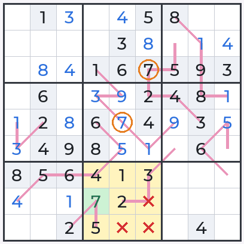

#### Step 22: the 8 in box 8

Box 8 needs an 8. r8c6 and r9c6: column 6 has one (r2c6). Only **r9c5** is left: **r9c5 = 8**.

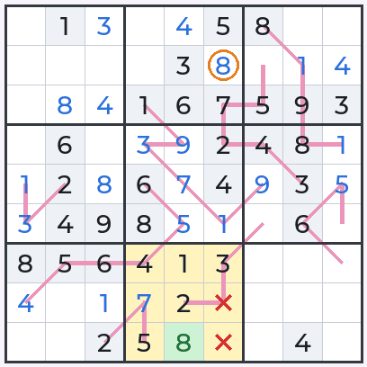

#### Step 23: the 9 in box 8

Box 8 needs a 9. r8c6: with a 9 there, its pink line's pairs couldn't all add up to the same. Only **r9c6** is left: **r9c6 = 9**.

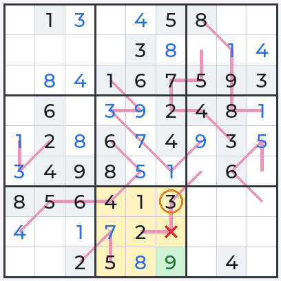

#### Step 24: the 9 in box 7

Box 7 needs a 9. r9c1 and r9c2: row 9 has one (r9c6). Only **r8c2** is left: **r8c2 = 9**.

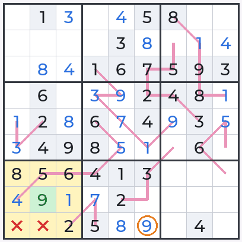

#### Step 25: the 3 in box 7

Box 7 needs a 3. r9c1: column 1 has one (r6c1). Only **r9c2** is left: **r9c2 = 3**.

#### Step 26: the 7 in box 7

Box 7 needs a 7, and r9c1 is its last empty cell: **r9c1 = 7**.

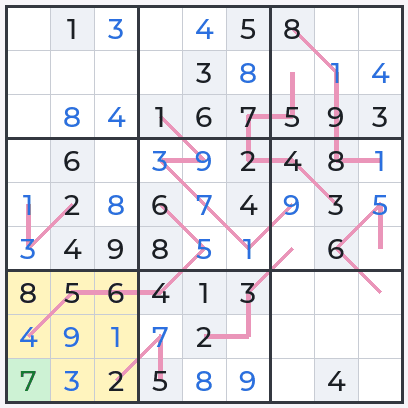

#### Step 27: the 7 in box 4

Box 4 needs a 7. r4c1: column 1 has one (r9c1). Only **r4c3** is left: **r4c3 = 7**.

#### Step 28: the 7 in box 1

Box 1 needs a 7. r1c1 and r2c1: column 1 has one (r9c1). r2c3: column 3 has one (r4c3). r3c1: row 3 has one (r3c6). Only **r2c2** is left: **r2c2 = 7**.

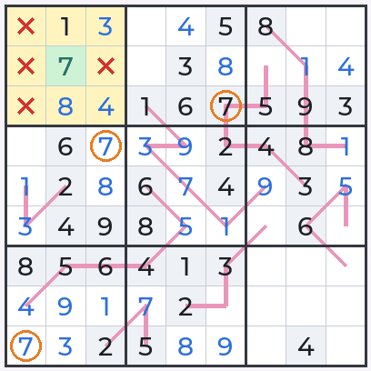

#### Step 29: the 5 in box 4

Box 4 needs a 5, and r4c1 is its last empty cell: **r4c1 = 5**.

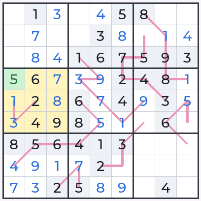

#### Step 30: the 5 in box 1

Box 1 needs a 5. r1c1: row 1 has one (r1c6). r2c1: column 1 has one (r4c1). r3c1: row 3 has one (r3c7). Only **r2c3** is left: **r2c3 = 5**.

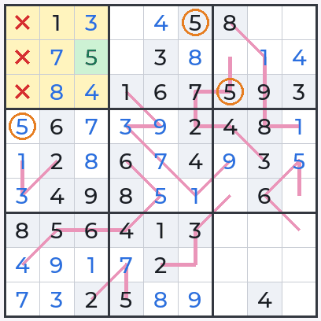

#### Step 31: the 6 in box 8

Box 8 needs a 6, and r8c6 is its last empty cell: **r8c6 = 6**.

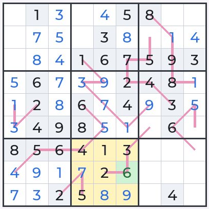

#### Step 32: the 2 in box 6

Box 6 needs a 2. r6c7: it pairs with the 2 in r8c5 on its pink line, whose pairs add up to 9: it's 7. Only **r6c9** is left: **r6c9 = 2**.

#### Step 33: the 2 in box 3

Box 3 needs a 2. r1c9: column 9 has one (r6c9). r2c7: it pairs with the 3 in r5c8 on its pink line, whose pairs add up to 9: it's 6. Only **r1c8** is left: **r1c8 = 2**.

#### Step 34: the 2 in box 2

Box 2 needs a 2. r1c4: row 1 has one (r1c8). Only **r2c4** is left: **r2c4 = 2**.

#### Step 35: the 2 in box 1

Box 1 needs a 2. r1c1: row 1 has one (r1c8). r2c1: row 2 has one (r2c4). Only **r3c1** is left: **r3c1 = 2**.

#### Step 36: the 9 in box 2

Box 2 needs a 9, and r1c4 is its last empty cell: **r1c4 = 9**.

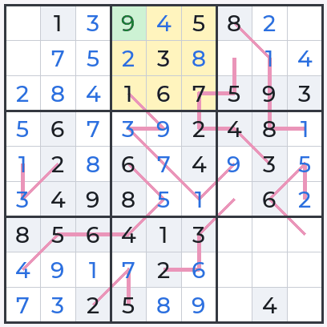

#### Step 37: the 9 in box 1

Box 1 needs a 9. r1c1: row 1 has one (r1c4). Only **r2c1** is left: **r2c1 = 9**.

#### Step 38: the 6 in box 1

Box 1 needs a 6, and r1c1 is its last empty cell: **r1c1 = 6**.

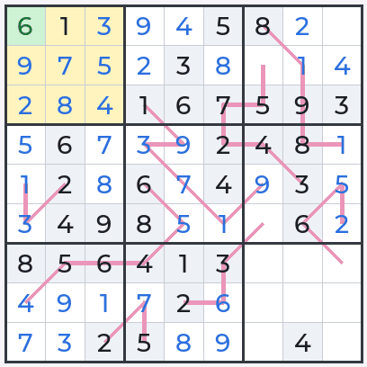

#### Step 39: the 6 in box 3

Box 3 needs a 6. r1c9: row 1 has one (r1c1). Only **r2c7** is left: **r2c7 = 6**.

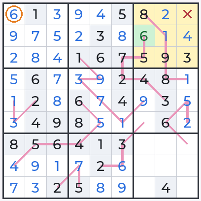

#### Step 40: the 7 in box 3

Box 3 needs a 7, and r1c9 is its last empty cell: **r1c9 = 7**.

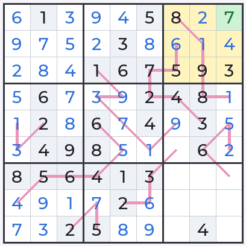

#### Step 41: the 7 in box 6

Box 6 needs a 7, and r6c7 is its last empty cell: **r6c7 = 7**.

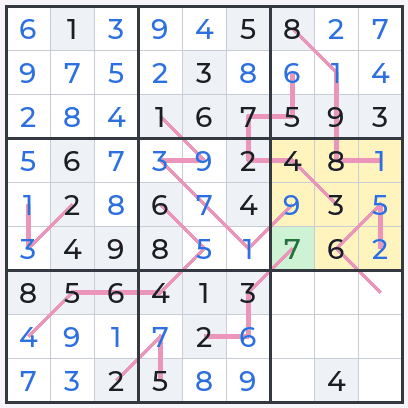

#### Step 42: the 1 in box 9

Box 9 needs a 1. r7c7, r7c8 and r7c9: row 7 has one (r7c5). r8c7, r8c8 and r8c9: row 8 has one (r8c3). r9c9: column 9 has one (r4c9). Only **r9c7** is left: **r9c7 = 1**.

#### Step 43: the 2 in box 9

Box 9 needs a 2. r7c8: column 8 has one (r1c8). r7c9: column 9 has one (r6c9). r8c7, r8c8 and r8c9: row 8 has one (r8c5). r9c9: row 9 has one (r9c3). Only **r7c7** is left: **r7c7 = 2**.

#### Step 44: the 3 in box 9

Box 9 needs a 3. r7c8 and r7c9: row 7 has one (r7c6). r8c8: column 8 has one (r5c8). r8c9: column 9 has one (r3c9). r9c9: row 9 has one (r9c2). Only **r8c7** is left: **r8c7 = 3**.

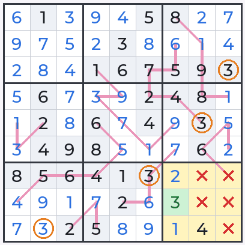

#### Step 45: the 5 in box 9

Box 9 needs a 5. r7c8 and r7c9: row 7 has one (r7c2). r8c9: column 9 has one (r5c9). r9c9: row 9 has one (r9c4). Only **r8c8** is left: **r8c8 = 5**.

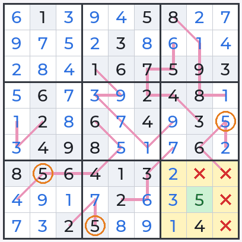

#### Step 46: the 6 in box 9

Box 9 needs a 6. r7c8 and r7c9: row 7 has one (r7c3). r8c9: row 8 has one (r8c6). Only **r9c9** is left: **r9c9 = 6**.

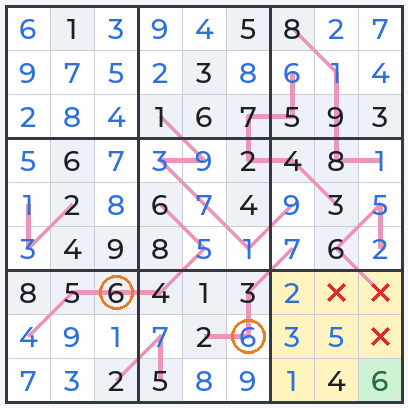

#### Step 47: the 7 in box 9

Box 9 needs a 7. r7c9: column 9 has one (r1c9). r8c9: row 8 has one (r8c4). Only **r7c8** is left: **r7c8 = 7**.

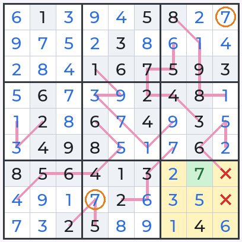

#### Step 48: the 8 in box 9

Box 9 needs an 8. r7c9: row 7 has one (r7c1). Only **r8c9** is left: **r8c9 = 8**.

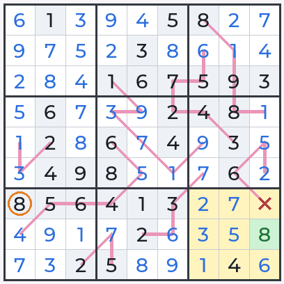

#### Step 49: the 9 in box 9

Box 9 needs a 9, and r7c9 is its last empty cell: **r7c9 = 9**.

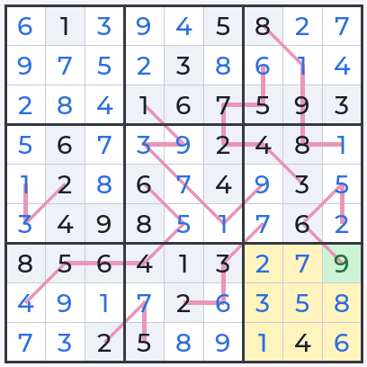

Solved.

<!-- /walkthrough -->
