# Zipper Lines

[← All variants](README.md) · [Puzzles](../features-puzzles.md) · [How to play](../how-to-play.md)

## The rules

[Classic](classic.md) rules, plus **pink lines** through cells side by side or diagonal. Fold a line in half at its middle: every two cells that meet **add up to the same total**. On a line with a middle cell (an odd number of cells), that total is the **middle cell's digit**: 1, 3, 7, 4, 6 works because 1 + 6 = 3 + 4 = 7. On a line without one, the total is whatever the two middle cells add up to.

Two cells that pair up may hold the same digit when they don't share a row, column or box (2 + 2 = 4).

## On the board

- Each line is a narrow pink line under the digits.
- Two full pairs with different totals, or (on an odd line) a pair that can't make the middle digit any more, turn red.
- The grader and hints work out the totals the line can still have, from its middle cell and its other pairs, and each cell's digit as a total less its partner's: "Cells the same distance from this line's middle add up to the same total, so row 6, column 5 can only be 5".
- **Puzzles → ⋮ → New puzzle → Lines → Zipper**: 8 lines (Hard and Expert 10) of 3 to 7 cells.

## How to solve it

- **The middle digit is the total:** on an odd line, every pair adds up to it, so every other cell on the line is smaller than it. A middle 2 means 1 + 1 everywhere.
- **One full pair gives the total** for every other pair on the line (and the middle digit, on an odd line).
- **Partners are complements:** once the total is known, a cell's candidates are the total less its partner's candidates.
- **Small totals, small digits:** a total of 5 keeps every cell on the line to 1–4.

## Worked example

**variant-examples #29**, Zipper Lines Easy (see [Classic](classic.md#worked-example-the-whole-puzzle) for how to import the examples; cells are written r*row*c*column*). The lines are in the screenshot; two matter here:

- a line of **seven** around the top of box 3: r2c7, r3c7 (a 3), r2c8 (an 8), r1c8 (its middle), r1c7, r1c6 (a 6) and r2c6;
- another line of **seven** in the bottom middle: r8c4, r9c4 (a 1), r8c5, r9c5 (an 8, its middle), r9c6 (a 3), r9c7 and r8c7.

**Step 1: r1c8, the middle of the first line.** Row 1 has 2, 3, 4 and 6; column 8 has 5 and 8; box 3 has a 7: that leaves 1 and 9. Its 2nd and 6th cells pair up: 3 + 6 = 9, so every pair adds up to 9, and so is the middle. **r1c8 = 9**.

**Step 2: r1c7, the same line's 5th cell.** Row 1 now has 2, 3, 4, 6 and 9; box 3 has 7 and 8: that leaves 1 and 5. It pairs with the 3rd cell, r2c8, an 8: 8 + r1c7 = 9. **r1c7 = 1**.

**Step 3: r8c5, the second line's 3rd cell.** Row 8 has 1, 3 and 9; column 5 has 1, 2, 4 and 8; box 8 has 2, 3, 7 and 8: that leaves 5 and 6. The line's middle is an 8, so every pair adds up to 8, and r8c5 pairs with r9c6, a 3. **r8c5 = 5**.

## The whole puzzle, step by step

<!-- walkthrough -->
<!-- Written by tools/walkthrough.py zipper-lines: edit the script, not this part. -->

The whole puzzle, from the start to the last cell: 53 steps, each one a single (one place left for a digit, or one digit left for a cell), taken in the order a box's single comes first, so not quite the order of the worked example above. In each picture, the unit the step looks at is tinted yellow (for a cell with one digit left: its row, column and box), the new digit is on green, the digits that rule cells out have an **orange ring**, and the empty cells they rule out a **red cross**. Givens are on grey, digits from earlier steps in blue.

#### Step 1: the 8 in box 2

Box 2 needs an 8. r2c5 and r2c6: row 2 has one (r2c8). Only **r3c4** is left: **r3c4 = 8**.

#### Step 2: the 3 in box 7

Box 7 needs a 3. r8c1 and r8c3: row 8 has one (r8c9). r9c1, r9c2 and r9c3: row 9 has one (r9c6). Only **r7c2** is left: **r7c2 = 3**.

#### Step 3: the 4 in box 7

Box 7 needs a 4. r8c1 and r9c1: column 1 has one (r3c1). r8c3 and r9c3: column 3 has one (r4c3). Only **r9c2** is left: **r9c2 = 4**.

#### Step 4: the 8 in box 7

Box 7 needs an 8. r9c1 and r9c3: row 9 has one (r9c5). r8c1: with an 8 there, its pink line's pairs couldn't all add up to the same. Only **r8c3** is left: **r8c3 = 8**.

#### Step 5: the 8 in box 1

Box 1 needs an 8. r1c3: column 3 has one (r8c3). r2c2 and r2c3: row 2 has one (r2c8). r3c2 and r3c3: row 3 has one (r3c4). Only **r1c1** is left: **r1c1 = 8**.

#### Step 6: the 2 in box 7

Box 7 needs a 2. r8c1: it pairs with the 5 in r7c1 on its pink line, whose pairs add up to 12: it's 7. r9c1: it pairs with the 3 in r7c2 on its pink line, whose pairs add up to 12: it's 9. Only **r9c3** is left: **r9c3 = 2**.

#### Step 7: the 7 in box 7

Box 7 needs a 7. r9c1: it pairs with the 3 in r7c2 on its pink line, whose pairs add up to 12: it's 9. Only **r8c1** is left: **r8c1 = 7**.

#### Step 8: the 9 in box 7

Box 7 needs a 9, and r9c1 is its last empty cell: **r9c1 = 9**.

#### Step 9: the 6 in box 8

Box 8 needs a 6. r7c6: row 7 has one (r7c3). r8c5: it pairs with the 3 in r9c6 on its pink line, whose pairs add up to 8: it's 5. Only **r8c4** is left: **r8c4 = 6**.

#### Step 10: the 4 in box 8

Box 8 needs a 4. r8c5: column 5 has one (r1c5). Only **r7c6** is left: **r7c6 = 4**.

#### Step 11: the 5 in box 8

Box 8 needs a 5, and r8c5 is its last empty cell: **r8c5 = 5**.

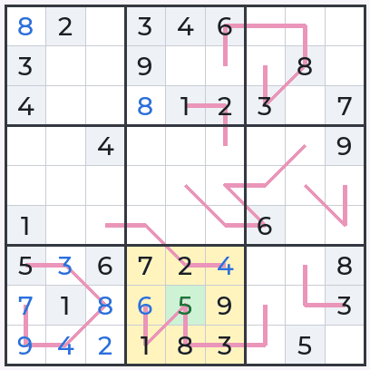

#### Step 12: the 5 in box 2

Box 2 needs a 5. r2c5: column 5 has one (r8c5). Only **r2c6** is left: **r2c6 = 5**.

#### Step 13: the 7 in box 2

Box 2 needs a 7, and r2c5 is its last empty cell: **r2c5 = 7**.

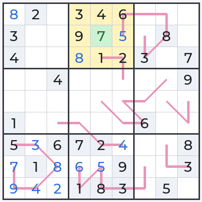

#### Step 14: the 7 in box 1

Box 1 needs a 7. r2c2 and r2c3: row 2 has one (r2c5). r3c2 and r3c3: row 3 has one (r3c9). Only **r1c3** is left: **r1c3 = 7**.

#### Step 15: the 1 in box 1

Box 1 needs a 1. r2c2: column 2 has one (r8c2). r3c2 and r3c3: row 3 has one (r3c5). Only **r2c3** is left: **r2c3 = 1**.

#### Step 16: the 2 in box 3

Box 3 needs a 2. r1c7, r1c8 and r1c9: row 1 has one (r1c2). r3c8: row 3 has one (r3c6). r2c7: it pairs with the 5 in r2c6 on its pink line, whose pairs add up to 9: it's 4. Only **r2c9** is left: **r2c9 = 2**.

#### Step 17: the 4 in box 3

Box 3 needs a 4. r1c7, r1c8 and r1c9: row 1 has one (r1c5). r3c8: row 3 has one (r3c1). Only **r2c7** is left: **r2c7 = 4**.

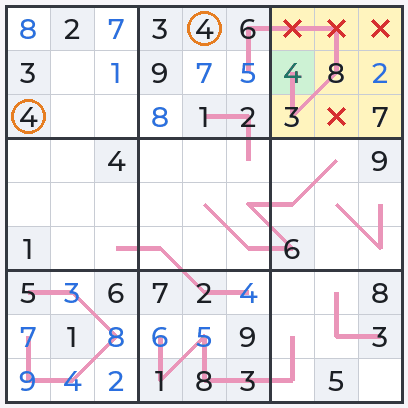

#### Step 18: the 5 in box 3

Box 3 needs a 5. r1c8 and r3c8: column 8 has one (r9c8). r1c7: it pairs with the 8 in r2c8 on its pink line, whose pairs add up to 9: it's 1. Only **r1c9** is left: **r1c9 = 5**.

#### Step 19: the 1 in box 3

Box 3 needs a 1. r3c8: row 3 has one (r3c5). r1c8: its place on its thermometer keeps it between 2 and 9. Only **r1c7** is left: **r1c7 = 1**.

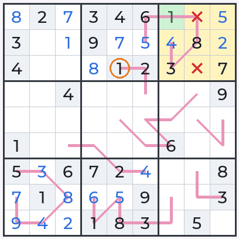

#### Step 20: the 6 in box 3

Box 3 needs a 6. r1c8: row 1 has one (r1c6). Only **r3c8** is left: **r3c8 = 6**.

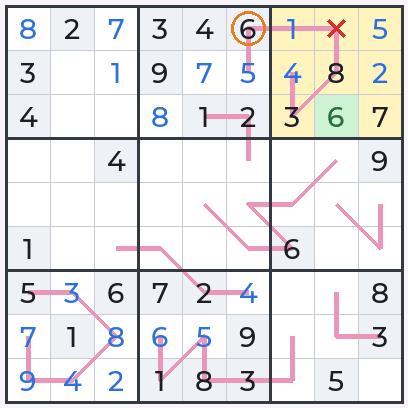

#### Step 21: the 6 in box 1

Box 1 needs a 6. r3c2 and r3c3: row 3 has one (r3c8). Only **r2c2** is left: **r2c2 = 6**.

#### Step 22: the 9 in box 3

Box 3 needs a 9, and r1c8 is its last empty cell: **r1c8 = 9**.

#### Step 23: the 1 in box 9

Box 9 needs a 1. r7c7: column 7 has one (r1c7). r8c7 and r8c8: row 8 has one (r8c2). r9c7 and r9c9: row 9 has one (r9c4). Only **r7c8** is left: **r7c8 = 1**.

#### Step 24: the 1 in box 6

Box 6 needs a 1. r4c7 and r5c7: column 7 has one (r1c7). r4c8 and r5c8: column 8 has one (r7c8). r6c8 and r6c9: row 6 has one (r6c1). Only **r5c9** is left: **r5c9 = 1**.

#### Step 25: the 1 in box 5

Box 5 needs a 1. r4c4: column 4 has one (r9c4). r4c5: column 5 has one (r3c5). r5c4, r5c5 and r5c6: row 5 has one (r5c9). r6c4, r6c5 and r6c6: row 6 has one (r6c1). Only **r4c6** is left: **r4c6 = 1**.

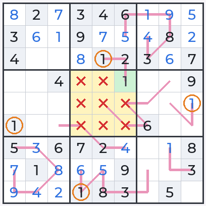

#### Step 26: the 2 in box 9

Box 9 needs a 2. r7c7: row 7 has one (r7c5). r9c7 and r9c9: row 9 has one (r9c3). r8c8: it's the middle of its pink line, whose pairs add up to 4. Only **r8c7** is left: **r8c7 = 2**.

#### Step 27: the 4 in box 9

Box 9 needs a 4. r7c7: row 7 has one (r7c6). r9c7 and r9c9: row 9 has one (r9c2). Only **r8c8** is left: **r8c8 = 4**.

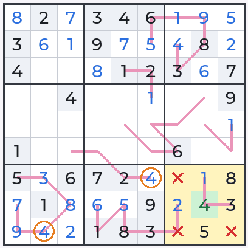

#### Step 28: the 4 in box 6

Box 6 needs a 4. r4c7 and r4c8: row 4 has one (r4c3). r5c7: column 7 has one (r2c7). r5c8 and r6c8: column 8 has one (r8c8). Only **r6c9** is left: **r6c9 = 4**.

#### Step 29: the 4 in box 5

Box 5 needs a 4. r4c4 and r4c5: row 4 has one (r4c3). r5c5: column 5 has one (r1c5). r5c6: column 6 has one (r7c6). r6c4, r6c5 and r6c6: row 6 has one (r6c9). Only **r5c4** is left: **r5c4 = 4**.

#### Step 30: the 2 in box 5

Box 5 needs a 2. r4c5, r5c5 and r6c5: column 5 has one (r7c5). r5c6 and r6c6: column 6 has one (r3c6). r6c4: with a 2 there, its pink line's pairs couldn't all add up to the same. Only **r4c4** is left: **r4c4 = 2**.

#### Step 31: the 2 in box 4

Box 4 needs a 2. r4c1 and r4c2: row 4 has one (r4c4). r5c2 and r6c2: column 2 has one (r1c2). r5c3 and r6c3: column 3 has one (r9c3). Only **r5c1** is left: **r5c1 = 2**.

#### Step 32: the 6 in box 4

Box 4 needs a 6. r4c2 and r5c2: column 2 has one (r2c2). r5c3: column 3 has one (r7c3). r6c2 and r6c3: row 6 has one (r6c7). Only **r4c1** is left: **r4c1 = 6**.

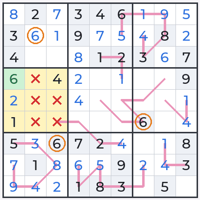

#### Step 33: the 5 in box 5

Box 5 needs a 5. r4c5, r5c5 and r6c5: column 5 has one (r8c5). r5c6 and r6c6: column 6 has one (r2c6). Only **r6c4** is left: **r6c4 = 5**.

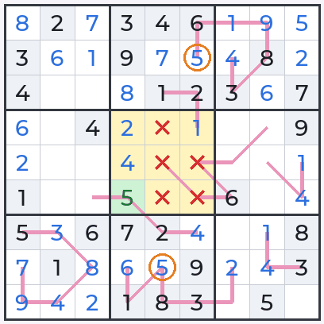

#### Step 34: the 6 in box 5

Box 5 needs a 6. r4c5: row 4 has one (r4c1). r5c6: column 6 has one (r1c6). r6c5 and r6c6: row 6 has one (r6c7). Only **r5c5** is left: **r5c5 = 6**.

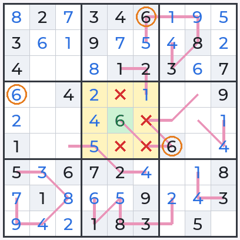

#### Step 35: the 9 in box 5

Box 5 needs a 9. r4c5: row 4 has one (r4c9). r5c6 and r6c6: column 6 has one (r8c6). Only **r6c5** is left: **r6c5 = 9**.

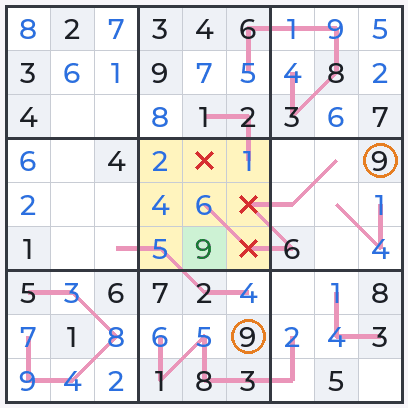

#### Step 36: the 3 in box 5

Box 5 needs a 3. r5c6 and r6c6: column 6 has one (r9c6). Only **r4c5** is left: **r4c5 = 3**.

#### Step 37: the 2 in box 6

Box 6 needs a 2. r4c7 and r4c8: row 4 has one (r4c4). r5c7 and r5c8: row 5 has one (r5c1). Only **r6c8** is left: **r6c8 = 2**.

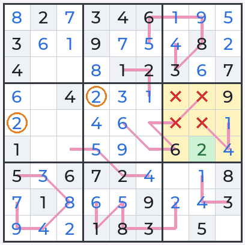

#### Step 38: the 3 in box 6

Box 6 needs a 3. r4c7 and r4c8: row 4 has one (r4c5). r5c7: column 7 has one (r3c7). Only **r5c8** is left: **r5c8 = 3**.

#### Step 39: the 3 in box 4

Box 4 needs a 3. r4c2: row 4 has one (r4c5). r5c2 and r5c3: row 5 has one (r5c8). r6c2: column 2 has one (r7c2). Only **r6c3** is left: **r6c3 = 3**.

#### Step 40: the 6 in box 9

Box 9 needs a 6. r7c7: row 7 has one (r7c3). r9c7: column 7 has one (r6c7). Only **r9c9** is left: **r9c9 = 6**.

#### Step 41: the 7 in box 9

Box 9 needs a 7. r7c7: row 7 has one (r7c4). Only **r9c7** is left: **r9c7 = 7**.

#### Step 42: the 7 in box 6

Box 6 needs a 7. r4c7 and r5c7: column 7 has one (r9c7). Only **r4c8** is left: **r4c8 = 7**.

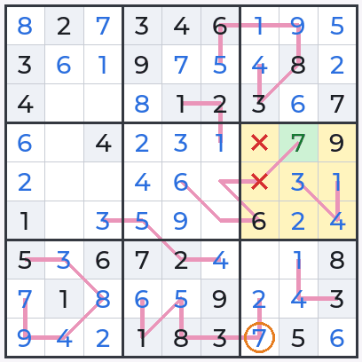

#### Step 43: the 8 in box 5

Box 5 needs an 8. r5c6: it pairs with the 6 in r6c7 on its pink line, whose pairs add up to 13: it's 7. Only **r6c6** is left: **r6c6 = 8**.

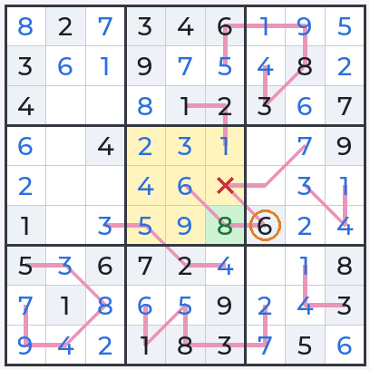

#### Step 44: the 7 in box 5

Box 5 needs a 7, and r5c6 is its last empty cell: **r5c6 = 7**.

#### Step 45: the 7 in box 4

Box 4 needs a 7. r4c2: row 4 has one (r4c8). r5c2 and r5c3: row 5 has one (r5c6). Only **r6c2** is left: **r6c2 = 7**.

#### Step 46: the 8 in box 6

Box 6 needs an 8. r5c7: it pairs with the 8 in r6c6 on its pink line, whose pairs add up to 13: it's 5. Only **r4c7** is left: **r4c7 = 8**.

#### Step 47: the 8 in box 4

Box 4 needs an 8. r4c2: row 4 has one (r4c7). r5c3: column 3 has one (r8c3). Only **r5c2** is left: **r5c2 = 8**.

#### Step 48: the 9 in box 4

Box 4 needs a 9. r4c2: row 4 has one (r4c9). Only **r5c3** is left: **r5c3 = 9**.

#### Step 49: the 9 in box 1

Box 1 needs a 9. r3c3: column 3 has one (r5c3). Only **r3c2** is left: **r3c2 = 9**.

#### Step 50: the 5 in box 1

Box 1 needs a 5, and r3c3 is its last empty cell: **r3c3 = 5**.

#### Step 51: the 5 in box 4

Box 4 needs a 5, and r4c2 is its last empty cell: **r4c2 = 5**.

#### Step 52: the 5 in box 6

Box 6 needs a 5, and r5c7 is its last empty cell: **r5c7 = 5**.

#### Step 53: the 9 in box 9

Box 9 needs a 9, and r7c7 is its last empty cell: **r7c7 = 9**.

Solved.

<!-- /walkthrough -->
