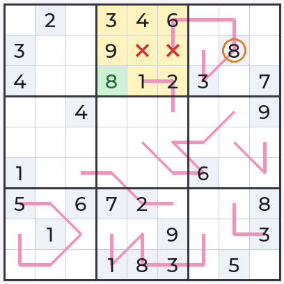

<!-- Written by tools/walkthrough.py zipper-lines: edit the script, not this page. -->
# Zipper Lines, step 1: the 8 in box 2

**Step 1 of 53** · [← The start](../zipper-lines.md#the-whole-puzzle-step-by-step) · [All steps](../zipper-lines.md#the-whole-puzzle-step-by-step) · [Step 2 →](step-02.md)

Box 2 needs an 8. r2c5 and r2c6: row 2 has one (r2c8). Only **r3c4** is left: **r3c4 = 8**.

**Step 1 of 53** · [← The start](../zipper-lines.md#the-whole-puzzle-step-by-step) · [All steps](../zipper-lines.md#the-whole-puzzle-step-by-step) · [Step 2 →](step-02.md)
