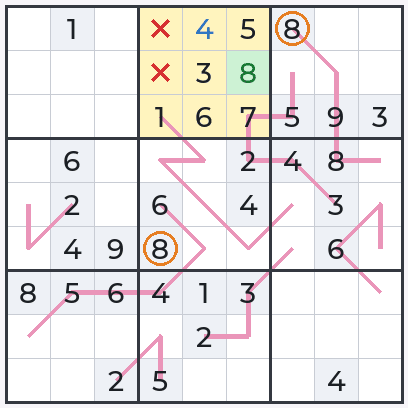

<!-- Written by tools/walkthrough.py zipper-lines: edit the script, not this page. -->
# Zipper Lines, step 2: the 3 in box 7

**Step 2 of 53** · [← Step 1](step-01.md) · [All steps](../zipper-lines.md#the-whole-puzzle-step-by-step) · [Step 3 →](step-03.md)

Box 7 needs a 3. r8c1 and r8c3: row 8 has one (r8c9). r9c1, r9c2 and r9c3: row 9 has one (r9c6). Only **r7c2** is left: **r7c2 = 3**.

**Step 2 of 53** · [← Step 1](step-01.md) · [All steps](../zipper-lines.md#the-whole-puzzle-step-by-step) · [Step 3 →](step-03.md)
