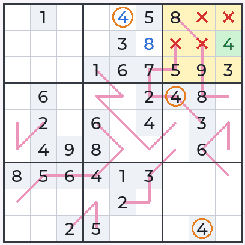

<!-- Written by tools/walkthrough.py zipper-lines: edit the script, not this page. -->
# Zipper Lines, step 3: the 4 in box 7

**Step 3 of 53** · [← Step 2](step-02.md) · [All steps](../zipper-lines.md#the-whole-puzzle-step-by-step) · [Step 4 →](step-04.md)

Box 7 needs a 4. r8c1 and r9c1: column 1 has one (r3c1). r8c3 and r9c3: column 3 has one (r4c3). Only **r9c2** is left: **r9c2 = 4**.

**Step 3 of 53** · [← Step 2](step-02.md) · [All steps](../zipper-lines.md#the-whole-puzzle-step-by-step) · [Step 4 →](step-04.md)
