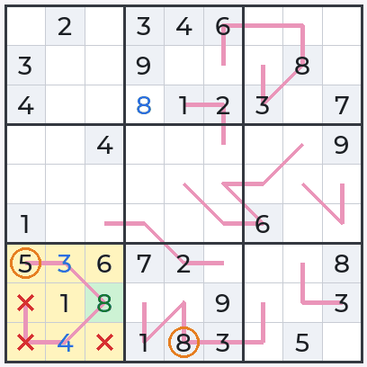

<!-- Written by tools/walkthrough.py zipper-lines: edit the script, not this page. -->
# Zipper Lines, step 4: the 8 in box 7

**Step 4 of 53** · [← Step 3](step-03.md) · [All steps](../zipper-lines.md#the-whole-puzzle-step-by-step) · [Step 5 →](step-05.md)

Box 7 needs an 8. r9c1 and r9c3: row 9 has one (r9c5). r8c1: with an 8 there, its pink line's pairs couldn't all add up to the same. Only **r8c3** is left: **r8c3 = 8**.

**Step 4 of 53** · [← Step 3](step-03.md) · [All steps](../zipper-lines.md#the-whole-puzzle-step-by-step) · [Step 5 →](step-05.md)
