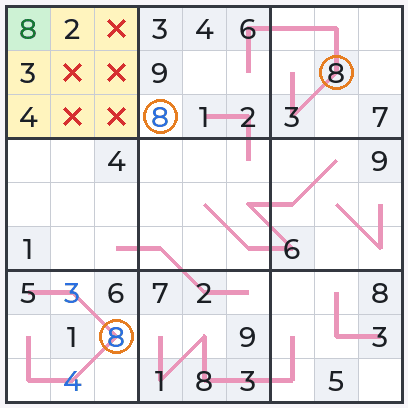

<!-- Written by tools/walkthrough.py zipper-lines: edit the script, not this page. -->
# Zipper Lines, step 5: the 8 in box 1

**Step 5 of 53** · [← Step 4](step-04.md) · [All steps](../zipper-lines.md#the-whole-puzzle-step-by-step) · [Step 6 →](step-06.md)

Box 1 needs an 8. r1c3: column 3 has one (r8c3). r2c2 and r2c3: row 2 has one (r2c8). r3c2 and r3c3: row 3 has one (r3c4). Only **r1c1** is left: **r1c1 = 8**.

**Step 5 of 53** · [← Step 4](step-04.md) · [All steps](../zipper-lines.md#the-whole-puzzle-step-by-step) · [Step 6 →](step-06.md)
