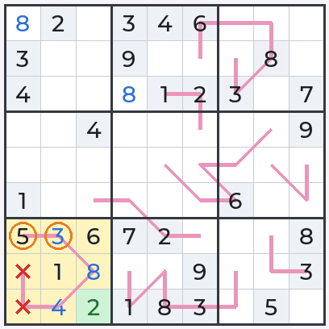

<!-- Written by tools/walkthrough.py zipper-lines: edit the script, not this page. -->
# Zipper Lines, step 6: the 2 in box 7

**Step 6 of 53** · [← Step 5](step-05.md) · [All steps](../zipper-lines.md#the-whole-puzzle-step-by-step) · [Step 7 →](step-07.md)

Box 7 needs a 2. r8c1: it pairs with the 5 in r7c1 on its pink line, whose pairs add up to 12: it's 7. r9c1: it pairs with the 3 in r7c2 on its pink line, whose pairs add up to 12: it's 9. Only **r9c3** is left: **r9c3 = 2**.

**Step 6 of 53** · [← Step 5](step-05.md) · [All steps](../zipper-lines.md#the-whole-puzzle-step-by-step) · [Step 7 →](step-07.md)
