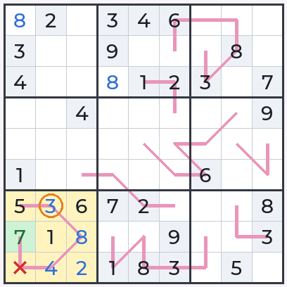

<!-- Written by tools/walkthrough.py zipper-lines: edit the script, not this page. -->
# Zipper Lines, step 7: the 7 in box 7

**Step 7 of 53** · [← Step 6](step-06.md) · [All steps](../zipper-lines.md#the-whole-puzzle-step-by-step) · [Step 8 →](step-08.md)

Box 7 needs a 7. r9c1: it pairs with the 3 in r7c2 on its pink line, whose pairs add up to 12: it's 9. Only **r8c1** is left: **r8c1 = 7**.

**Step 7 of 53** · [← Step 6](step-06.md) · [All steps](../zipper-lines.md#the-whole-puzzle-step-by-step) · [Step 8 →](step-08.md)
