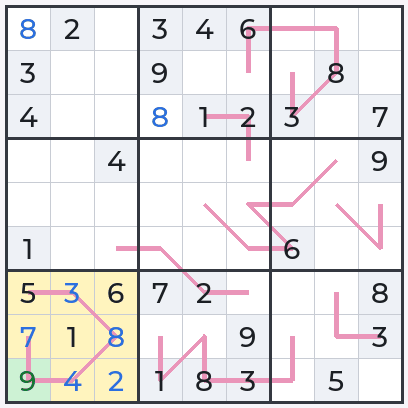

<!-- Written by tools/walkthrough.py zipper-lines: edit the script, not this page. -->
# Zipper Lines, step 8: the 9 in box 7

**Step 8 of 53** · [← Step 7](step-07.md) · [All steps](../zipper-lines.md#the-whole-puzzle-step-by-step) · [Step 9 →](step-09.md)

Box 7 needs a 9, and r9c1 is its last empty cell: **r9c1 = 9**.

**Step 8 of 53** · [← Step 7](step-07.md) · [All steps](../zipper-lines.md#the-whole-puzzle-step-by-step) · [Step 9 →](step-09.md)
