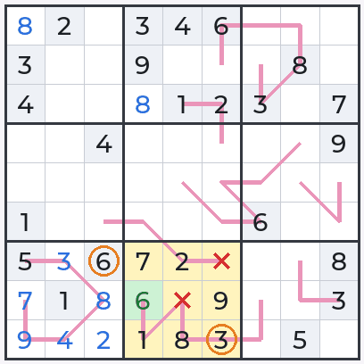

<!-- Written by tools/walkthrough.py zipper-lines: edit the script, not this page. -->
# Zipper Lines, step 9: the 6 in box 8

**Step 9 of 53** · [← Step 8](step-08.md) · [All steps](../zipper-lines.md#the-whole-puzzle-step-by-step) · [Step 10 →](step-10.md)

Box 8 needs a 6. r7c6: row 7 has one (r7c3). r8c5: it pairs with the 3 in r9c6 on its pink line, whose pairs add up to 8: it's 5. Only **r8c4** is left: **r8c4 = 6**.

**Step 9 of 53** · [← Step 8](step-08.md) · [All steps](../zipper-lines.md#the-whole-puzzle-step-by-step) · [Step 10 →](step-10.md)
