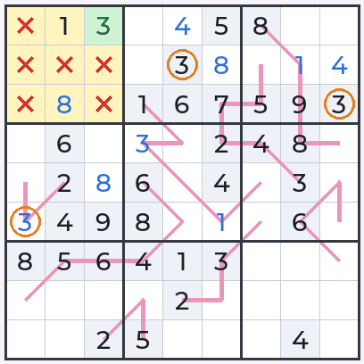

<!-- Written by tools/walkthrough.py zipper-lines: edit the script, not this page. -->
# Zipper Lines, step 10: the 4 in box 8

**Step 10 of 53** · [← Step 9](step-09.md) · [All steps](../zipper-lines.md#the-whole-puzzle-step-by-step) · [Step 11 →](step-11.md)

Box 8 needs a 4. r8c5: column 5 has one (r1c5). Only **r7c6** is left: **r7c6 = 4**.

**Step 10 of 53** · [← Step 9](step-09.md) · [All steps](../zipper-lines.md#the-whole-puzzle-step-by-step) · [Step 11 →](step-11.md)
