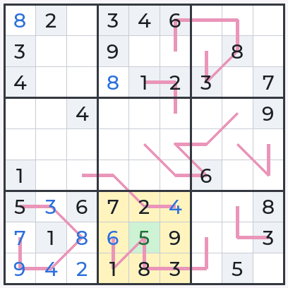

<!-- Written by tools/walkthrough.py zipper-lines: edit the script, not this page. -->
# Zipper Lines, step 11: the 5 in box 8

**Step 11 of 53** · [← Step 10](step-10.md) · [All steps](../zipper-lines.md#the-whole-puzzle-step-by-step) · [Step 12 →](step-12.md)

Box 8 needs a 5, and r8c5 is its last empty cell: **r8c5 = 5**.

**Step 11 of 53** · [← Step 10](step-10.md) · [All steps](../zipper-lines.md#the-whole-puzzle-step-by-step) · [Step 12 →](step-12.md)
