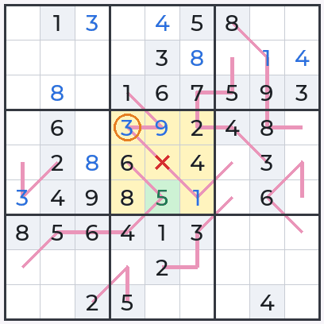

<!-- Written by tools/walkthrough.py zipper-lines: edit the script, not this page. -->
# Zipper Lines, step 12: the 5 in box 2

**Step 12 of 53** · [← Step 11](step-11.md) · [All steps](../zipper-lines.md#the-whole-puzzle-step-by-step) · [Step 13 →](step-13.md)

Box 2 needs a 5. r2c5: column 5 has one (r8c5). Only **r2c6** is left: **r2c6 = 5**.

**Step 12 of 53** · [← Step 11](step-11.md) · [All steps](../zipper-lines.md#the-whole-puzzle-step-by-step) · [Step 13 →](step-13.md)
