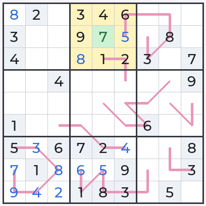

<!-- Written by tools/walkthrough.py zipper-lines: edit the script, not this page. -->
# Zipper Lines, step 13: the 7 in box 2

**Step 13 of 53** · [← Step 12](step-12.md) · [All steps](../zipper-lines.md#the-whole-puzzle-step-by-step) · [Step 14 →](step-14.md)

Box 2 needs a 7, and r2c5 is its last empty cell: **r2c5 = 7**.

**Step 13 of 53** · [← Step 12](step-12.md) · [All steps](../zipper-lines.md#the-whole-puzzle-step-by-step) · [Step 14 →](step-14.md)
