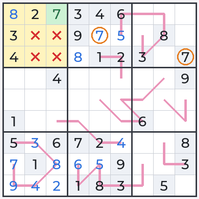

<!-- Written by tools/walkthrough.py zipper-lines: edit the script, not this page. -->
# Zipper Lines, step 14: the 7 in box 1

**Step 14 of 53** · [← Step 13](step-13.md) · [All steps](../zipper-lines.md#the-whole-puzzle-step-by-step) · [Step 15 →](step-15.md)

Box 1 needs a 7. r2c2 and r2c3: row 2 has one (r2c5). r3c2 and r3c3: row 3 has one (r3c9). Only **r1c3** is left: **r1c3 = 7**.

**Step 14 of 53** · [← Step 13](step-13.md) · [All steps](../zipper-lines.md#the-whole-puzzle-step-by-step) · [Step 15 →](step-15.md)
