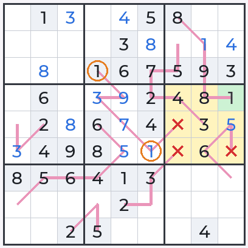

<!-- Written by tools/walkthrough.py zipper-lines: edit the script, not this page. -->
# Zipper Lines, step 15: the 1 in box 1

**Step 15 of 53** · [← Step 14](step-14.md) · [All steps](../zipper-lines.md#the-whole-puzzle-step-by-step) · [Step 16 →](step-16.md)

Box 1 needs a 1. r2c2: column 2 has one (r8c2). r3c2 and r3c3: row 3 has one (r3c5). Only **r2c3** is left: **r2c3 = 1**.

**Step 15 of 53** · [← Step 14](step-14.md) · [All steps](../zipper-lines.md#the-whole-puzzle-step-by-step) · [Step 16 →](step-16.md)
