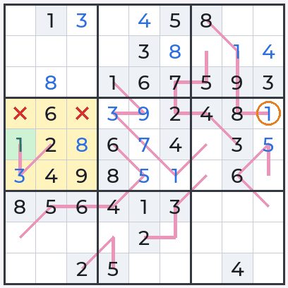

<!-- Written by tools/walkthrough.py zipper-lines: edit the script, not this page. -->
# Zipper Lines, step 16: the 2 in box 3

**Step 16 of 53** · [← Step 15](step-15.md) · [All steps](../zipper-lines.md#the-whole-puzzle-step-by-step) · [Step 17 →](step-17.md)

Box 3 needs a 2. r1c7, r1c8 and r1c9: row 1 has one (r1c2). r3c8: row 3 has one (r3c6). r2c7: it pairs with the 5 in r2c6 on its pink line, whose pairs add up to 9: it's 4. Only **r2c9** is left: **r2c9 = 2**.

**Step 16 of 53** · [← Step 15](step-15.md) · [All steps](../zipper-lines.md#the-whole-puzzle-step-by-step) · [Step 17 →](step-17.md)
