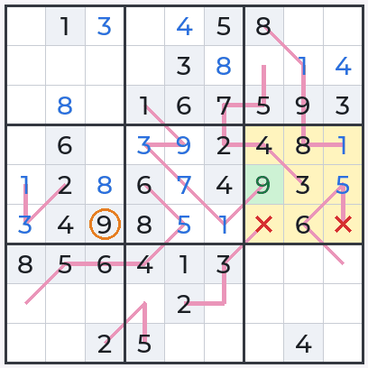

<!-- Written by tools/walkthrough.py zipper-lines: edit the script, not this page. -->
# Zipper Lines, step 17: the 4 in box 3

**Step 17 of 53** · [← Step 16](step-16.md) · [All steps](../zipper-lines.md#the-whole-puzzle-step-by-step) · [Step 18 →](step-18.md)

Box 3 needs a 4. r1c7, r1c8 and r1c9: row 1 has one (r1c5). r3c8: row 3 has one (r3c1). Only **r2c7** is left: **r2c7 = 4**.

**Step 17 of 53** · [← Step 16](step-16.md) · [All steps](../zipper-lines.md#the-whole-puzzle-step-by-step) · [Step 18 →](step-18.md)
