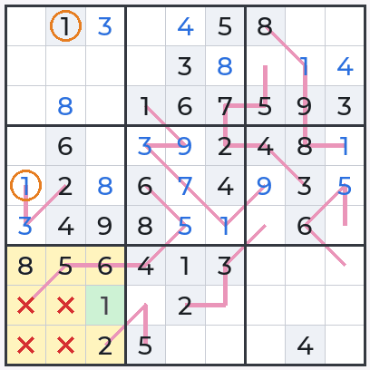

<!-- Written by tools/walkthrough.py zipper-lines: edit the script, not this page. -->
# Zipper Lines, step 18: the 5 in box 3

**Step 18 of 53** · [← Step 17](step-17.md) · [All steps](../zipper-lines.md#the-whole-puzzle-step-by-step) · [Step 19 →](step-19.md)

Box 3 needs a 5. r1c8 and r3c8: column 8 has one (r9c8). r1c7: it pairs with the 8 in r2c8 on its pink line, whose pairs add up to 9: it's 1. Only **r1c9** is left: **r1c9 = 5**.

**Step 18 of 53** · [← Step 17](step-17.md) · [All steps](../zipper-lines.md#the-whole-puzzle-step-by-step) · [Step 19 →](step-19.md)
