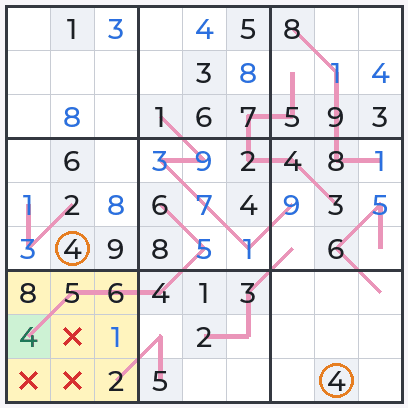

<!-- Written by tools/walkthrough.py zipper-lines: edit the script, not this page. -->
# Zipper Lines, step 19: the 1 in box 3

**Step 19 of 53** · [← Step 18](step-18.md) · [All steps](../zipper-lines.md#the-whole-puzzle-step-by-step) · [Step 20 →](step-20.md)

Box 3 needs a 1. r3c8: row 3 has one (r3c5). r1c8: its place on its thermometer keeps it between 2 and 9. Only **r1c7** is left: **r1c7 = 1**.

**Step 19 of 53** · [← Step 18](step-18.md) · [All steps](../zipper-lines.md#the-whole-puzzle-step-by-step) · [Step 20 →](step-20.md)
