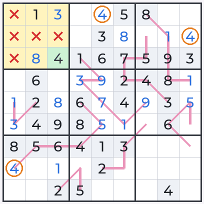

<!-- Written by tools/walkthrough.py zipper-lines: edit the script, not this page. -->
# Zipper Lines, step 20: the 6 in box 3

**Step 20 of 53** · [← Step 19](step-19.md) · [All steps](../zipper-lines.md#the-whole-puzzle-step-by-step) · [Step 21 →](step-21.md)

Box 3 needs a 6. r1c8: row 1 has one (r1c6). Only **r3c8** is left: **r3c8 = 6**.

**Step 20 of 53** · [← Step 19](step-19.md) · [All steps](../zipper-lines.md#the-whole-puzzle-step-by-step) · [Step 21 →](step-21.md)
