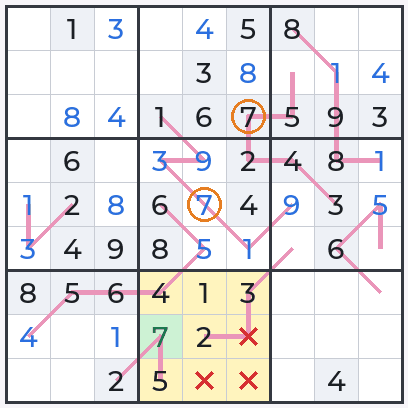

<!-- Written by tools/walkthrough.py zipper-lines: edit the script, not this page. -->
# Zipper Lines, step 21: the 6 in box 1

**Step 21 of 53** · [← Step 20](step-20.md) · [All steps](../zipper-lines.md#the-whole-puzzle-step-by-step) · [Step 22 →](step-22.md)

Box 1 needs a 6. r3c2 and r3c3: row 3 has one (r3c8). Only **r2c2** is left: **r2c2 = 6**.

**Step 21 of 53** · [← Step 20](step-20.md) · [All steps](../zipper-lines.md#the-whole-puzzle-step-by-step) · [Step 22 →](step-22.md)
