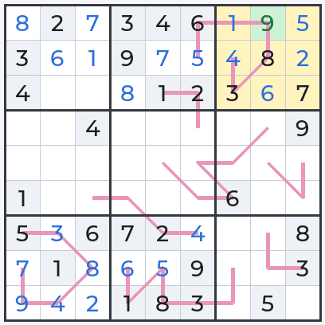

<!-- Written by tools/walkthrough.py zipper-lines: edit the script, not this page. -->
# Zipper Lines, step 22: the 9 in box 3

**Step 22 of 53** · [← Step 21](step-21.md) · [All steps](../zipper-lines.md#the-whole-puzzle-step-by-step) · [Step 23 →](step-23.md)

Box 3 needs a 9, and r1c8 is its last empty cell: **r1c8 = 9**.

**Step 22 of 53** · [← Step 21](step-21.md) · [All steps](../zipper-lines.md#the-whole-puzzle-step-by-step) · [Step 23 →](step-23.md)
