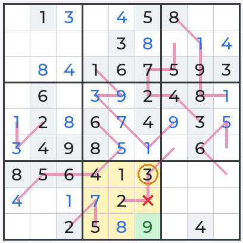

<!-- Written by tools/walkthrough.py zipper-lines: edit the script, not this page. -->
# Zipper Lines, step 23: the 1 in box 9

**Step 23 of 53** · [← Step 22](step-22.md) · [All steps](../zipper-lines.md#the-whole-puzzle-step-by-step) · [Step 24 →](step-24.md)

Box 9 needs a 1. r7c7: column 7 has one (r1c7). r8c7 and r8c8: row 8 has one (r8c2). r9c7 and r9c9: row 9 has one (r9c4). Only **r7c8** is left: **r7c8 = 1**.

**Step 23 of 53** · [← Step 22](step-22.md) · [All steps](../zipper-lines.md#the-whole-puzzle-step-by-step) · [Step 24 →](step-24.md)
