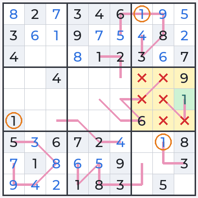

<!-- Written by tools/walkthrough.py zipper-lines: edit the script, not this page. -->
# Zipper Lines, step 24: the 1 in box 6

**Step 24 of 53** · [← Step 23](step-23.md) · [All steps](../zipper-lines.md#the-whole-puzzle-step-by-step) · [Step 25 →](step-25.md)

Box 6 needs a 1. r4c7 and r5c7: column 7 has one (r1c7). r4c8 and r5c8: column 8 has one (r7c8). r6c8 and r6c9: row 6 has one (r6c1). Only **r5c9** is left: **r5c9 = 1**.

**Step 24 of 53** · [← Step 23](step-23.md) · [All steps](../zipper-lines.md#the-whole-puzzle-step-by-step) · [Step 25 →](step-25.md)
