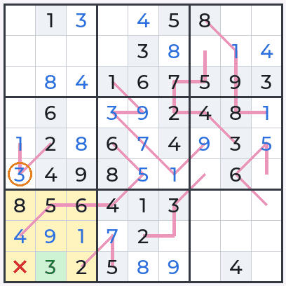

<!-- Written by tools/walkthrough.py zipper-lines: edit the script, not this page. -->
# Zipper Lines, step 25: the 1 in box 5

**Step 25 of 53** · [← Step 24](step-24.md) · [All steps](../zipper-lines.md#the-whole-puzzle-step-by-step) · [Step 26 →](step-26.md)

Box 5 needs a 1. r4c4: column 4 has one (r9c4). r4c5: column 5 has one (r3c5). r5c4, r5c5 and r5c6: row 5 has one (r5c9). r6c4, r6c5 and r6c6: row 6 has one (r6c1). Only **r4c6** is left: **r4c6 = 1**.

**Step 25 of 53** · [← Step 24](step-24.md) · [All steps](../zipper-lines.md#the-whole-puzzle-step-by-step) · [Step 26 →](step-26.md)
