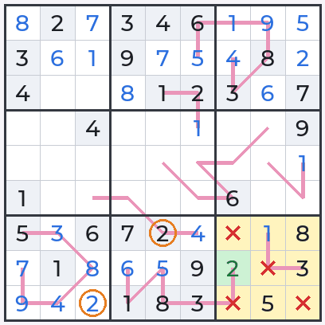

<!-- Written by tools/walkthrough.py zipper-lines: edit the script, not this page. -->
# Zipper Lines, step 26: the 2 in box 9

**Step 26 of 53** · [← Step 25](step-25.md) · [All steps](../zipper-lines.md#the-whole-puzzle-step-by-step) · [Step 27 →](step-27.md)

Box 9 needs a 2. r7c7: row 7 has one (r7c5). r9c7 and r9c9: row 9 has one (r9c3). r8c8: it's the middle of its pink line, whose pairs add up to 4. Only **r8c7** is left: **r8c7 = 2**.

**Step 26 of 53** · [← Step 25](step-25.md) · [All steps](../zipper-lines.md#the-whole-puzzle-step-by-step) · [Step 27 →](step-27.md)
