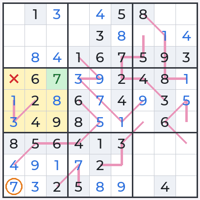

<!-- Written by tools/walkthrough.py zipper-lines: edit the script, not this page. -->
# Zipper Lines, step 27: the 4 in box 9

**Step 27 of 53** · [← Step 26](step-26.md) · [All steps](../zipper-lines.md#the-whole-puzzle-step-by-step) · [Step 28 →](step-28.md)

Box 9 needs a 4. r7c7: row 7 has one (r7c6). r9c7 and r9c9: row 9 has one (r9c2). Only **r8c8** is left: **r8c8 = 4**.

**Step 27 of 53** · [← Step 26](step-26.md) · [All steps](../zipper-lines.md#the-whole-puzzle-step-by-step) · [Step 28 →](step-28.md)
