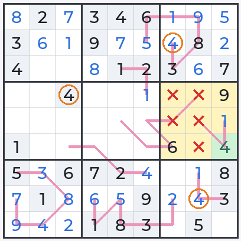

<!-- Written by tools/walkthrough.py zipper-lines: edit the script, not this page. -->
# Zipper Lines, step 28: the 4 in box 6

**Step 28 of 53** · [← Step 27](step-27.md) · [All steps](../zipper-lines.md#the-whole-puzzle-step-by-step) · [Step 29 →](step-29.md)

Box 6 needs a 4. r4c7 and r4c8: row 4 has one (r4c3). r5c7: column 7 has one (r2c7). r5c8 and r6c8: column 8 has one (r8c8). Only **r6c9** is left: **r6c9 = 4**.

**Step 28 of 53** · [← Step 27](step-27.md) · [All steps](../zipper-lines.md#the-whole-puzzle-step-by-step) · [Step 29 →](step-29.md)
