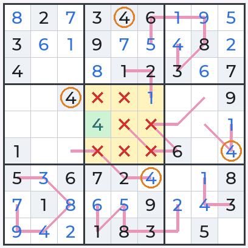

<!-- Written by tools/walkthrough.py zipper-lines: edit the script, not this page. -->
# Zipper Lines, step 29: the 4 in box 5

**Step 29 of 53** · [← Step 28](step-28.md) · [All steps](../zipper-lines.md#the-whole-puzzle-step-by-step) · [Step 30 →](step-30.md)

Box 5 needs a 4. r4c4 and r4c5: row 4 has one (r4c3). r5c5: column 5 has one (r1c5). r5c6: column 6 has one (r7c6). r6c4, r6c5 and r6c6: row 6 has one (r6c9). Only **r5c4** is left: **r5c4 = 4**.

**Step 29 of 53** · [← Step 28](step-28.md) · [All steps](../zipper-lines.md#the-whole-puzzle-step-by-step) · [Step 30 →](step-30.md)
