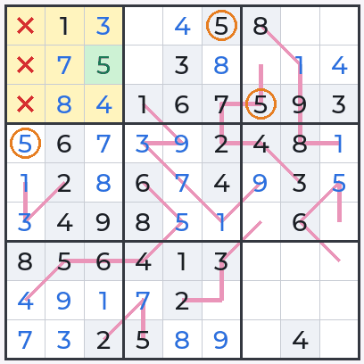

<!-- Written by tools/walkthrough.py zipper-lines: edit the script, not this page. -->
# Zipper Lines, step 30: the 2 in box 5

**Step 30 of 53** · [← Step 29](step-29.md) · [All steps](../zipper-lines.md#the-whole-puzzle-step-by-step) · [Step 31 →](step-31.md)

Box 5 needs a 2. r4c5, r5c5 and r6c5: column 5 has one (r7c5). r5c6 and r6c6: column 6 has one (r3c6). r6c4: with a 2 there, its pink line's pairs couldn't all add up to the same. Only **r4c4** is left: **r4c4 = 2**.

**Step 30 of 53** · [← Step 29](step-29.md) · [All steps](../zipper-lines.md#the-whole-puzzle-step-by-step) · [Step 31 →](step-31.md)
