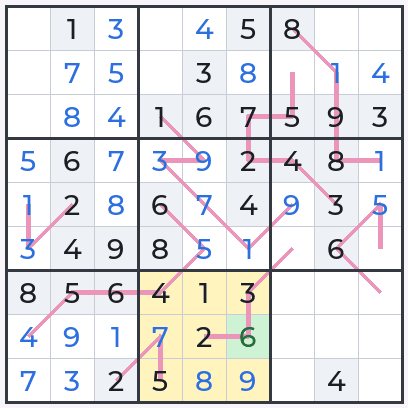

<!-- Written by tools/walkthrough.py zipper-lines: edit the script, not this page. -->
# Zipper Lines, step 31: the 2 in box 4

**Step 31 of 53** · [← Step 30](step-30.md) · [All steps](../zipper-lines.md#the-whole-puzzle-step-by-step) · [Step 32 →](step-32.md)

Box 4 needs a 2. r4c1 and r4c2: row 4 has one (r4c4). r5c2 and r6c2: column 2 has one (r1c2). r5c3 and r6c3: column 3 has one (r9c3). Only **r5c1** is left: **r5c1 = 2**.

**Step 31 of 53** · [← Step 30](step-30.md) · [All steps](../zipper-lines.md#the-whole-puzzle-step-by-step) · [Step 32 →](step-32.md)
