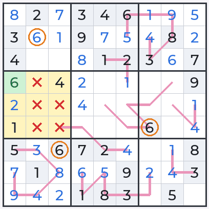

<!-- Written by tools/walkthrough.py zipper-lines: edit the script, not this page. -->
# Zipper Lines, step 32: the 6 in box 4

**Step 32 of 53** · [← Step 31](step-31.md) · [All steps](../zipper-lines.md#the-whole-puzzle-step-by-step) · [Step 33 →](step-33.md)

Box 4 needs a 6. r4c2 and r5c2: column 2 has one (r2c2). r5c3: column 3 has one (r7c3). r6c2 and r6c3: row 6 has one (r6c7). Only **r4c1** is left: **r4c1 = 6**.

**Step 32 of 53** · [← Step 31](step-31.md) · [All steps](../zipper-lines.md#the-whole-puzzle-step-by-step) · [Step 33 →](step-33.md)
