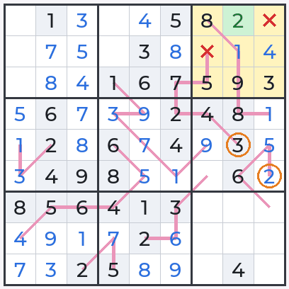

<!-- Written by tools/walkthrough.py zipper-lines: edit the script, not this page. -->
# Zipper Lines, step 33: the 5 in box 5

**Step 33 of 53** · [← Step 32](step-32.md) · [All steps](../zipper-lines.md#the-whole-puzzle-step-by-step) · [Step 34 →](step-34.md)

Box 5 needs a 5. r4c5, r5c5 and r6c5: column 5 has one (r8c5). r5c6 and r6c6: column 6 has one (r2c6). Only **r6c4** is left: **r6c4 = 5**.

**Step 33 of 53** · [← Step 32](step-32.md) · [All steps](../zipper-lines.md#the-whole-puzzle-step-by-step) · [Step 34 →](step-34.md)
