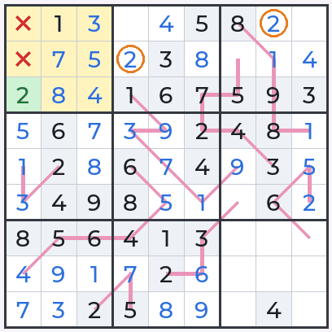

<!-- Written by tools/walkthrough.py zipper-lines: edit the script, not this page. -->
# Zipper Lines, step 35: the 9 in box 5

**Step 35 of 53** · [← Step 34](step-34.md) · [All steps](../zipper-lines.md#the-whole-puzzle-step-by-step) · [Step 36 →](step-36.md)

Box 5 needs a 9. r4c5: row 4 has one (r4c9). r5c6 and r6c6: column 6 has one (r8c6). Only **r6c5** is left: **r6c5 = 9**.

**Step 35 of 53** · [← Step 34](step-34.md) · [All steps](../zipper-lines.md#the-whole-puzzle-step-by-step) · [Step 36 →](step-36.md)
