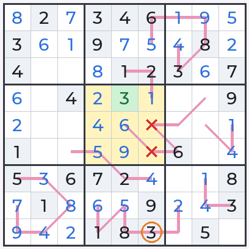

<!-- Written by tools/walkthrough.py zipper-lines: edit the script, not this page. -->
# Zipper Lines, step 36: the 3 in box 5

**Step 36 of 53** · [← Step 35](step-35.md) · [All steps](../zipper-lines.md#the-whole-puzzle-step-by-step) · [Step 37 →](step-37.md)

Box 5 needs a 3. r5c6 and r6c6: column 6 has one (r9c6). Only **r4c5** is left: **r4c5 = 3**.

**Step 36 of 53** · [← Step 35](step-35.md) · [All steps](../zipper-lines.md#the-whole-puzzle-step-by-step) · [Step 37 →](step-37.md)
