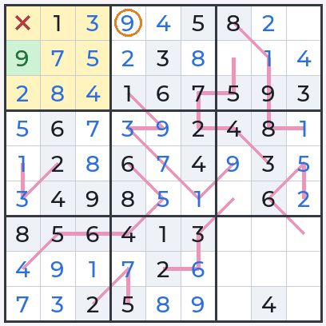

<!-- Written by tools/walkthrough.py zipper-lines: edit the script, not this page. -->
# Zipper Lines, step 37: the 2 in box 6

**Step 37 of 53** · [← Step 36](step-36.md) · [All steps](../zipper-lines.md#the-whole-puzzle-step-by-step) · [Step 38 →](step-38.md)

Box 6 needs a 2. r4c7 and r4c8: row 4 has one (r4c4). r5c7 and r5c8: row 5 has one (r5c1). Only **r6c8** is left: **r6c8 = 2**.

**Step 37 of 53** · [← Step 36](step-36.md) · [All steps](../zipper-lines.md#the-whole-puzzle-step-by-step) · [Step 38 →](step-38.md)
