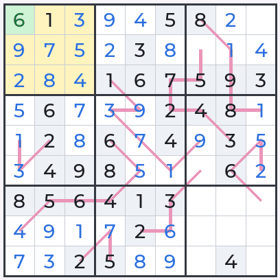

<!-- Written by tools/walkthrough.py zipper-lines: edit the script, not this page. -->
# Zipper Lines, step 38: the 3 in box 6

**Step 38 of 53** · [← Step 37](step-37.md) · [All steps](../zipper-lines.md#the-whole-puzzle-step-by-step) · [Step 39 →](step-39.md)

Box 6 needs a 3. r4c7 and r4c8: row 4 has one (r4c5). r5c7: column 7 has one (r3c7). Only **r5c8** is left: **r5c8 = 3**.

**Step 38 of 53** · [← Step 37](step-37.md) · [All steps](../zipper-lines.md#the-whole-puzzle-step-by-step) · [Step 39 →](step-39.md)
