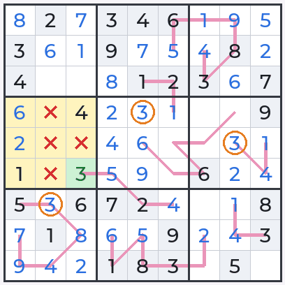

<!-- Written by tools/walkthrough.py zipper-lines: edit the script, not this page. -->
# Zipper Lines, step 39: the 3 in box 4

**Step 39 of 53** · [← Step 38](step-38.md) · [All steps](../zipper-lines.md#the-whole-puzzle-step-by-step) · [Step 40 →](step-40.md)

Box 4 needs a 3. r4c2: row 4 has one (r4c5). r5c2 and r5c3: row 5 has one (r5c8). r6c2: column 2 has one (r7c2). Only **r6c3** is left: **r6c3 = 3**.

**Step 39 of 53** · [← Step 38](step-38.md) · [All steps](../zipper-lines.md#the-whole-puzzle-step-by-step) · [Step 40 →](step-40.md)
