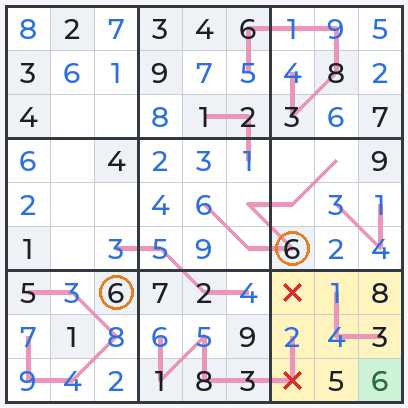

<!-- Written by tools/walkthrough.py zipper-lines: edit the script, not this page. -->
# Zipper Lines, step 40: the 6 in box 9

**Step 40 of 53** · [← Step 39](step-39.md) · [All steps](../zipper-lines.md#the-whole-puzzle-step-by-step) · [Step 41 →](step-41.md)

Box 9 needs a 6. r7c7: row 7 has one (r7c3). r9c7: column 7 has one (r6c7). Only **r9c9** is left: **r9c9 = 6**.

**Step 40 of 53** · [← Step 39](step-39.md) · [All steps](../zipper-lines.md#the-whole-puzzle-step-by-step) · [Step 41 →](step-41.md)
