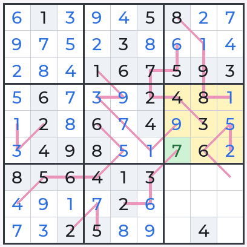

<!-- Written by tools/walkthrough.py zipper-lines: edit the script, not this page. -->
# Zipper Lines, step 41: the 7 in box 9

**Step 41 of 53** · [← Step 40](step-40.md) · [All steps](../zipper-lines.md#the-whole-puzzle-step-by-step) · [Step 42 →](step-42.md)

Box 9 needs a 7. r7c7: row 7 has one (r7c4). Only **r9c7** is left: **r9c7 = 7**.

**Step 41 of 53** · [← Step 40](step-40.md) · [All steps](../zipper-lines.md#the-whole-puzzle-step-by-step) · [Step 42 →](step-42.md)
