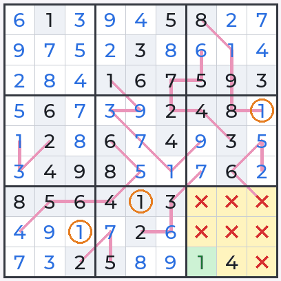

<!-- Written by tools/walkthrough.py zipper-lines: edit the script, not this page. -->
# Zipper Lines, step 42: the 7 in box 6

**Step 42 of 53** · [← Step 41](step-41.md) · [All steps](../zipper-lines.md#the-whole-puzzle-step-by-step) · [Step 43 →](step-43.md)

Box 6 needs a 7. r4c7 and r5c7: column 7 has one (r9c7). Only **r4c8** is left: **r4c8 = 7**.

**Step 42 of 53** · [← Step 41](step-41.md) · [All steps](../zipper-lines.md#the-whole-puzzle-step-by-step) · [Step 43 →](step-43.md)
